<picture>
  <source media="(prefers-color-scheme: dark)" srcset="assets/banner-dark.svg">
  <source media="(prefers-color-scheme: light)" srcset="assets/banner-light.svg">
  
</picture>

[Portfolio](https://samuelneveu.com) · [Book a call](https://cal.com/samuel-neveu-zxnzgm) · [LinkedIn](https://linkedin.com/in/samuel-neveu-29b7b0217) · [Malt](https://www.malt.fr/profile/samuelneveu) · [samuel.neveugall@gmail.com](mailto:samuel.neveugall@gmail.com)

I'm Samuel, a freelance iOS engineer between Paris and Rennes. Four years of native Swift and SwiftUI: apps on the App Store and Google Play, 500K+ users across them, not one App Store rejection, and a stretch on HelloWork's app (4M+ monthly users).

Since 2026, every mission I take is built with Claude Code. My weeks split three ways:

1. **Client work.** iOS apps, and the agent layer that sits behind them: tools, context, evals.
2. **Teaching.** Talks and workshops at Station F, and coaching developers and founders until they stop needing me.
3. **[VibeFlow OS](https://github.com/picmakpro/vibeflow-os).** The harness that makes the first two repeatable.

### VibeFlow OS

An AI harness for Claude Code. A request goes in, and a team of agents takes it from spec to plan to tested code, with a reviewer, an auditor and a design judge that never grade their own work. I wrote 1,600+ of its commits. It's how I shipped Somfy's Play Lab: 862 tests, 9 TestFlight builds, about 850 commits in three months.

<picture>
  <source media="(prefers-color-scheme: dark)" srcset="assets/vibeflow-dark.svg">
  <source media="(prefers-color-scheme: light)" srcset="assets/vibeflow-light.svg">
  
</picture>

My working rule: an agent without evals is a demo.

### Also open

- [prompt-eval-harness](https://github.com/samuel-neveugall/prompt-eval-harness): prompt evaluation as a Claude Code skill. Generated test cases, two graders, an improvement loop.
- [design-system-kit](https://github.com/samuel-neveugall/design-system-kit): set up a Next.js + Tailwind design system, then iterate on it daily, with two skills.
- [dev-agentic-starter](https://github.com/samuel-neveugall/dev-agentic-starter): the setup I hand to the people I train.
- [RoastMyRoom](https://github.com/samuel-neveugall/RoastMyRoom): an iOS app that judges your room, harshly. Vision model, StoreKit 2, Supabase.
- [Fractal-Explorer](https://github.com/samuel-neveugall/Fractal-Explorer): a Mandelbrot zoom in SwiftUI and Metal, using perturbation theory to dive past double precision.

### Client work

| Project | What it took |
|---|---|
| Somfy Play Lab | Trade-show app driving a motorized shade over Bluetooth LE. BLE stack decoded from the vendor's specs, commands down from 1.6 s to 0.2 s. |
| [Orange Travel](https://apps.apple.com/fr/app/orange-travel-esim-voyage/id1547958789) | eSIM app built from scratch in SwiftUI, five third-party SDKs behind one wrapper. Tech lead. |
| [HelloWork](https://apps.apple.com/fr/app/hellowork-recherche-demploi/id408615037) | Test coverage from 35% to 72%, crash rate under 0.1%. |
| Scroll-Off | Screen Time blocking engine on FamilyControls, tested on real iPhones because the simulator can't run it. |
| [Freelance, ça gagne combien ?](https://apps.apple.com/fr/app/freelance-ca-gagne-combien/id6759180336) | My own app. A French freelance net-income calculator on `Decimal`, fully offline. |

Swift, SwiftUI, Combine, StoreKit 2, CoreBluetooth, React Native, Go, TypeScript, Claude Agent SDK, MCP. Claude Certified Architect (Anthropic, 2026).

Got an iOS product to ship, or an agent to get under control? [Book a call](https://cal.com/samuel-neveu-zxnzgm).
